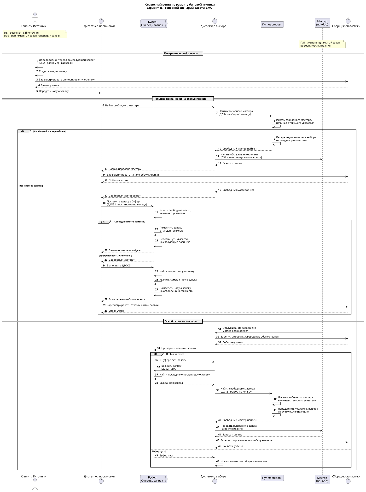
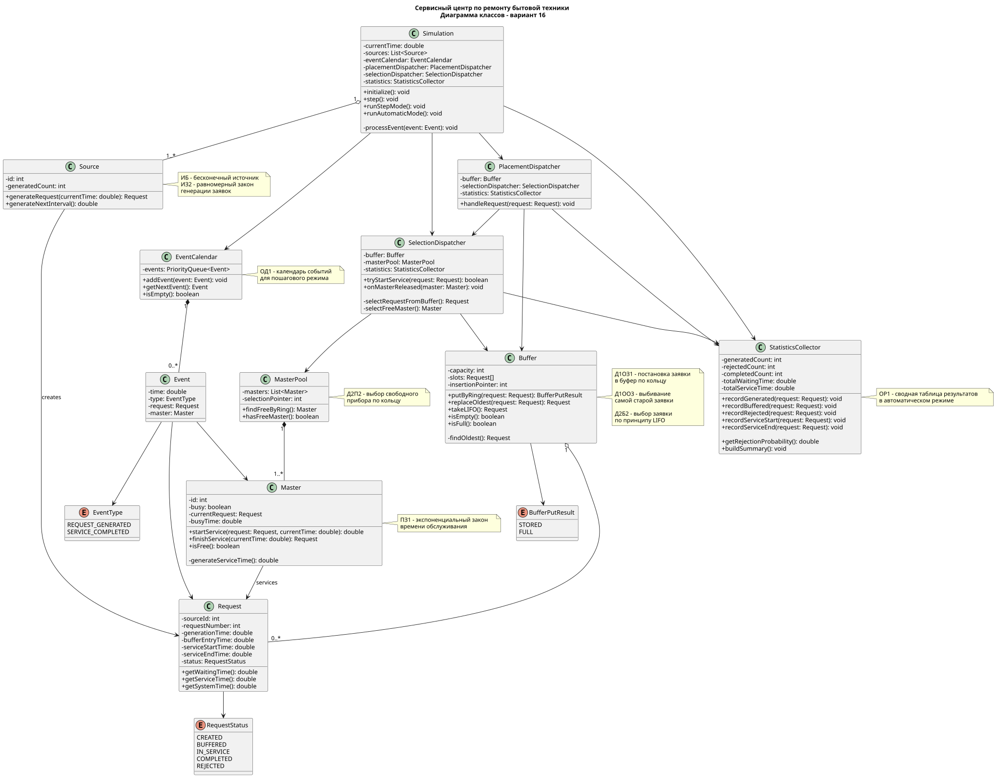
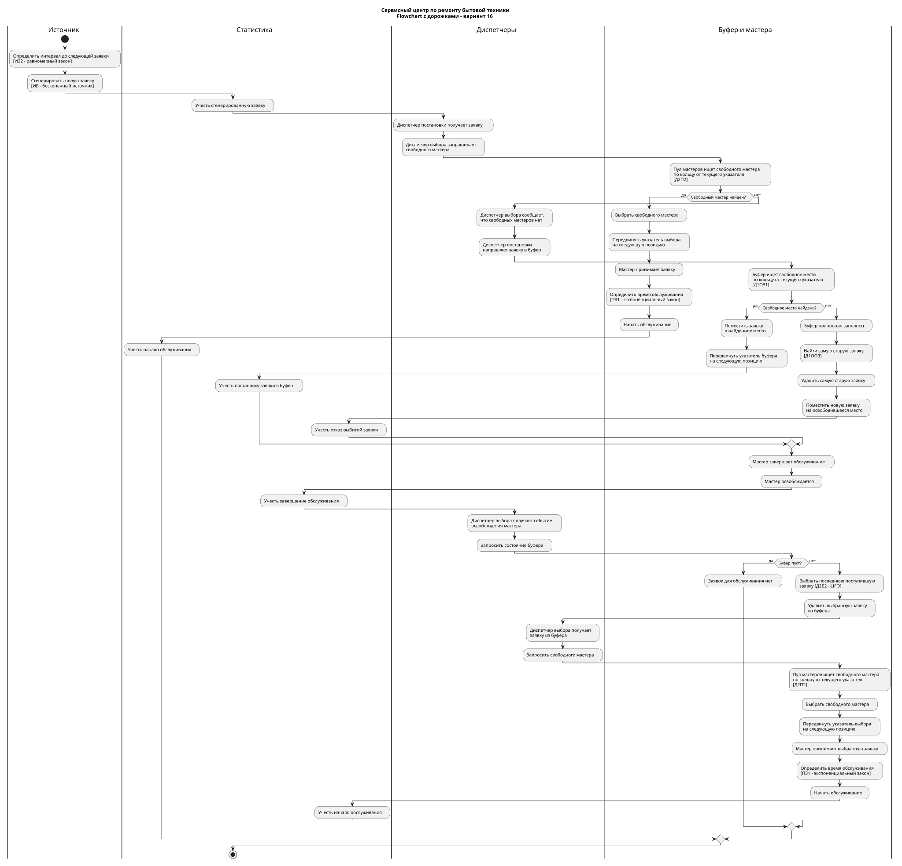

# Первичные артефакты

## Вариант

`ИБ ИЗ2 ПЗ1 Д1ОЗ1 Д1ОО3 Д2П2 Д2Б2 ОР1 ОД1`

## Расшифровка варианта

- **ИБ** - бесконечный источник заявок.
- **ИЗ2** - равномерный закон генерации заявок.
- **ПЗ1** - экспоненциальный закон времени обслуживания.
- **Д1ОЗ1** - постановка заявки в буфер по кольцу с использованием указателя.
- **Д1ОО3** - если буфер заполнен, из него удаляется самая старая заявка, а новая занимает её место.
- **Д2Б2** - выбор заявки из буфера по принципу LIFO.
- **Д2П2** - выбор свободного прибора по кольцу с использованием указателя.
- **ОР1** - сводная таблица результатов в автоматическом режиме.
- **ОД1** - в пошаговом режиме отображаются календарь событий, состояние буфера и текущее состояние системы.

## Бизнес-домен

Для проекта выбран сервисный центр по ремонту бытовой техники.

Клиенты обращаются в сервисный центр и создают заявки на ремонт техники. Заявка либо сразу передаётся свободному мастеру, либо ожидает обслуживания в буфере.

## Маппинг

| Элемент СМО | Бизнес-сущность |
|---|---|
| Источник | Клиент сервисного центра |
| Заявка | Заявка на ремонт бытовой техники |
| Буфер | Очередь заявок на ремонт |
| Прибор | Мастер сервисного центра |
| Диспетчер постановки | Система приёма заявок |
| Диспетчер выбора | Система распределения заявок между мастерами |
| Обслуживание | Диагностика и ремонт бытовой техники |
| Выход из системы | Отремонтированная техника / завершённая заявка |

## Логика работы системы

Источник генерирует заявки через равномерно распределённые интервалы времени.

После поступления новой заявки система проверяет наличие свободного мастера.

Если свободный мастер есть, заявка сразу передаётся ему на обслуживание.

Если все мастера заняты, заявка поступает в буфер.

Свободное место в буфере ищется по кольцу, начиная с текущего указателя.

После успешной постановки заявки указатель буфера перемещается на следующую позицию.

Если буфер полностью заполнен, из него удаляется самая старая заявка. Новая заявка занимает освободившееся место. Удалённая заявка считается получившей отказ.

Когда мастер освобождается, из буфера выбирается последняя поступившая заявка по принципу LIFO.

Свободный мастер выбирается по кольцу, начиная с текущего указателя выбора приборов.

После выбора свободного мастера указатель выбора приборов перемещается на следующую позицию.

Время обслуживания заявки определяется по экспоненциальному закону распределения.

Освобождение мастера является событием, после которого диспетчер выбора проверяет состояние буфера и при наличии заявки передаёт её на обслуживание.

## Указатели

Для кольцевых дисциплин используются два независимых указателя:

- `insertionPointer` - указатель постановки заявки в буфер для Д1ОЗ1;
- `selectionPointer` - указатель выбора свободного мастера для Д2П2.

## Событийная модель

Моделирование строится по принципу особых событий.

Календарь событий хранит события, упорядоченные по модельному времени.

Основные события:
- генерация новой заявки;
- постановка заявки в буфер;
- передача заявки мастеру;
- выбивание заявки из буфера;
- завершение обслуживания;
- освобождение мастера;
- выбор новой заявки из буфера.

## Пошаговый режим

В пошаговом режиме по ОД1 должны отображаться:
- текущее модельное время;
- текущее событие;
- календарь событий;
- состояние буфера;
- положение указателя буфера;
- состояние мастеров;
- положение указателя выбора мастеров;
- количество сгенерированных заявок;
- количество и процент отказов;
- текущая статистика системы.

## Автоматический режим

В автоматическом режиме по ОР1 формируется сводная таблица результатов моделирования.

В неё могут входить:
- количество сгенерированных заявок;
- количество обслуженных заявок;
- количество отказов;
- вероятность отказа;
- среднее время ожидания;
- среднее время обслуживания;
- среднее время нахождения заявки в системе;
- загрузка мастеров.

## Диаграммы

### Sequence diagram

Исходный файл: [main-flow.puml](diagrams/sequence/main-flow.puml)

На диаграмме показаны:
- генерация заявки;
- Happy Flow;
- поиск свободного мастера;
- выбор мастера по Д2П2;
- постановка заявки в буфер по Д1ОЗ1;
- переполнение буфера;
- выбивание самой старой заявки по Д1ОО3;
- выбор заявки из буфера по Д2Б2;
- освобождение мастера;
- повторная передача заявки на обслуживание;
- фиксация статистики.

### Диаграмма классов

Исходный файл: [class-diagram.puml](diagrams/class/class-diagram.puml)

На диаграмме показаны основные классы системы, их поля, методы и связи.

Отдельно отражены:
- `Buffer` с указателем `insertionPointer`;
- `MasterPool` с указателем `selectionPointer`;
- `EventCalendar`;
- `StatisticsCollector`;
- диспетчеры постановки и выбора;
- сущности заявки, мастера и события.

### Flowchart

Исходный файл: [system-flow.puml](diagrams/flowchart/system-flow.puml)

Flowchart показывает общий алгоритм работы системы, основные альтернативы и распределение действий между источником, статистикой, диспетчерами, буфером и мастерами.
