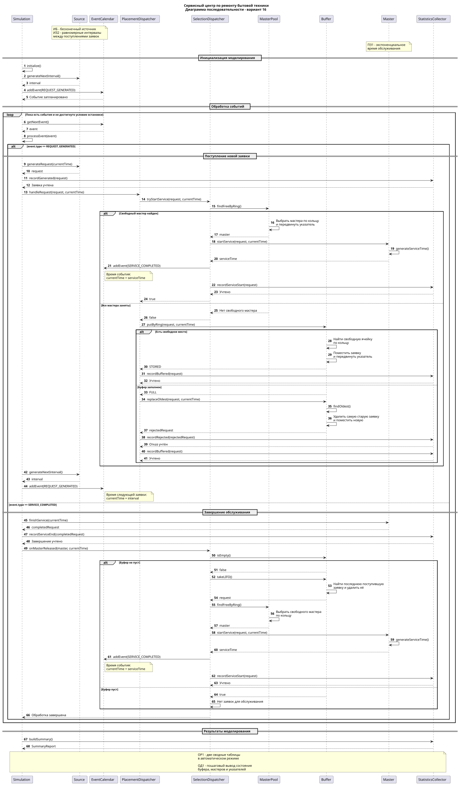
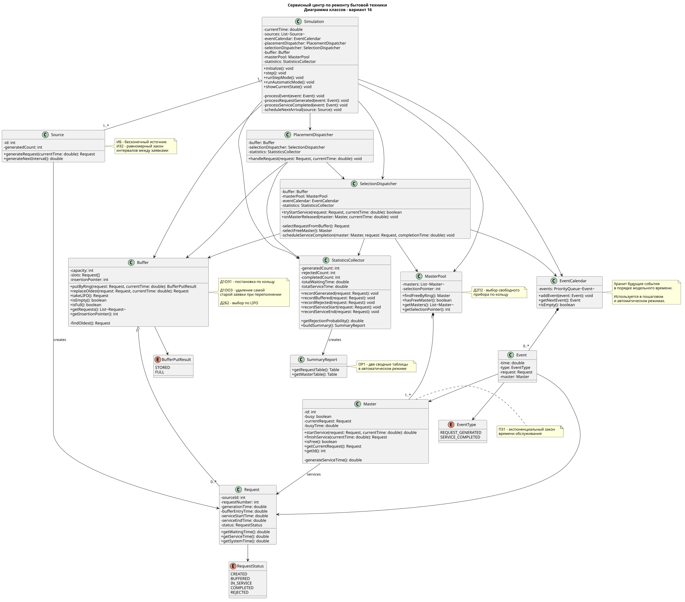
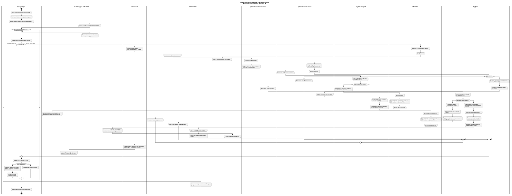

# Первичные артефакты

## Вариант

`ИБ ИЗ2 ПЗ1 Д1ОЗ1 Д1ОО3 Д2П2 Д2Б2 ОР1 ОД1`

## Расшифровка варианта

- **ИБ** - бесконечный источник заявок.
- **ИЗ2** - равномерный закон распределения интервалов между поступлениями заявок.
- **ПЗ1** - экспоненциальный закон времени обслуживания.
- **Д1ОЗ1** - постановка заявки в буфер по кольцу с использованием указателя.
- **Д1ОО3** - при переполнении буфера удаляется самая старая заявка, а новая занимает её место.
- **Д2Б2** - выбор заявки из буфера по принципу LIFO.
- **Д2П2** - выбор свободного прибора по кольцу с использованием указателя.
- **ОР1** - формирование двух сводных таблиц результатов в автоматическом режиме.
- **ОД1** - пошаговое отображение состояния системы после обработки каждого события.

## Бизнес-домен

Для проекта выбран сервисный центр по ремонту бытовой техники.

Клиенты обращаются в сервисный центр и создают заявки на ремонт техники. Заявка либо сразу передаётся свободному мастеру, либо ожидает обслуживания в буфере.

## Маппинг

| Элемент СМО | Бизнес-сущность |
|---|---|
| Источник | Клиент сервисного центра |
| Заявка | Заявка на ремонт бытовой техники |
| Буфер | Очередь заявок на ремонт |
| Прибор | Мастер сервисного центра |
| Диспетчер постановки | Система приёма заявок |
| Диспетчер выбора | Система распределения заявок между мастерами |
| Обслуживание | Диагностика и ремонт бытовой техники |
| Выход из системы | Завершённая заявка |

## Логика работы системы

Источник генерирует заявки через случайные интервалы времени по равномерному распределению.

После поступления заявки диспетчер постановки обращается к диспетчеру выбора для поиска свободного мастера.

Если свободный мастер найден, заявка сразу передаётся ему на обслуживание.

Время обслуживания определяется по экспоненциальному распределению. После начала обслуживания в календарь добавляется событие его завершения.

Если все мастера заняты, заявка направляется в общий буфер.

Свободная ячейка в буфере ищется по кольцу, начиная с текущего указателя постановки.

После успешного размещения заявки указатель перемещается на следующую позицию.

Если буфер полностью заполнен, удаляется заявка, которая находится в нём дольше остальных. Новая заявка занимает её место, а удалённая учитывается как отказ.

Завершение обслуживания является отдельным событием, не зависящим от поступления новых заявок.

Когда мастер заканчивает ремонт, система фиксирует завершение обслуживания и освобождает мастера.

После этого диспетчер выбора проверяет буфер.

Если буфер не пуст, выбирается последняя поступившая в него заявка по принципу LIFO.

Для обслуживания выбирается свободный мастер по кольцу, начиная с текущего указателя выбора приборов.

После успешного выбора мастера указатель перемещается на следующую позицию.

Если буфер пуст, мастер остаётся свободным до поступления следующей заявки.

## Указатели

Для кольцевых дисциплин используются два независимых указателя:

- `insertionPointer` - указатель постановки заявки в буфер по Д1ОЗ1;
- `selectionPointer` - указатель выбора свободного мастера по Д2П2.

Оба указателя перемещаются по кольцу. После последней позиции переходят к первой.

## Событийная модель

Моделирование выполняется по принципу дискретно-событийного моделирования.

Класс `Simulation` управляет процессом моделирования, а `EventCalendar` хранит запланированные события в порядке модельного времени.

Предусмотрены два основных типа событий:

- `REQUEST_GENERATED` - поступление новой заявки;
- `SERVICE_COMPLETED` - завершение обслуживания заявки.

При обработке события поступления заявки система создаёт заявку, пытается назначить свободного мастера или помещает заявку в буфер. Затем планируется следующее поступление заявки.

При обработке события завершения обслуживания мастер освобождается, а диспетчер выбора при наличии ожидающих заявок назначает следующую.

Постановка в буфер, вытеснение заявки, выбор мастера и начало обслуживания являются действиями, выполняемыми при обработке основных событий.

После начала обслуживания в календарь добавляется событие `SERVICE_COMPLETED` на рассчитанное время окончания ремонта.

Моделирование продолжается до выполнения заданного условия остановки.

## Пошаговый режим

В пошаговом режиме по ОД1 пользователь последовательно обрабатывает события с помощью команды «Следующий шаг».

Один шаг соответствует обработке одного события, а не фиксированному промежутку времени.

После каждого шага отображаются:

- текущее модельное время;
- обработанное событие;
- состояние буфера и находящиеся в нём заявки;
- положение указателя постановки в буфер;
- состояние мастеров;
- положение указателя выбора мастеров;
- количество сгенерированных заявок;
- количество и процент отказов;
- текущая статистика моделирования.

Календарь событий используется внутри программы, но его отдельное отображение не является обязательным.

## Автоматический режим

В автоматическом режиме события обрабатываются последовательно без ожидания действий пользователя.

По ОР1 формируются две итоговые сводные таблицы.

Первая таблица содержит общие результаты моделирования:

- количество сгенерированных заявок;
- количество обслуженных заявок;
- количество отказов;
- вероятность отказа;
- среднее время ожидания;
- среднее время обслуживания;
- среднее время нахождения заявки в системе.

Вторая таблица содержит статистику по мастерам:

- идентификатор мастера;
- количество обслуженных заявок;
- суммарное время занятости;
- коэффициент загрузки мастера.

## Основные классы

- `Source` - генерирует заявки и интервалы между их поступлениями.
- `Request` - хранит информацию о заявке и времени её обработки.
- `PlacementDispatcher` - отвечает за поступление и размещение заявок.
- `Buffer` - управляет хранением заявок, кольцевой постановкой, вытеснением и LIFO.
- `SelectionDispatcher` - выбирает свободного мастера и заявки из буфера.
- `MasterPool` - управляет набором мастеров и кольцевым указателем выбора.
- `Master` - выполняет обслуживание заявки.
- `Event` - представляет событие моделирования.
- `EventCalendar` - хранит будущие события.
- `StatisticsCollector` - собирает статистику моделирования.
- `SummaryReport` - предоставляет данные для итоговых таблиц.
- `Simulation` - управляет моделированием и режимами работы.

## Диаграммы

### Sequence diagram

Исходный файл: [main-flow.puml](diagrams/sequence/main-flow.puml)

На диаграмме показаны:

- инициализация моделирования;
- получение событий из календаря;
- поступление новой заявки;
- поиск свободного мастера;
- выбор мастера по Д2П2;
- постановка заявки в буфер по Д1ОЗ1;
- переполнение буфера;
- удаление самой старой заявки по Д1ОО3;
- завершение обслуживания как самостоятельное событие;
- выбор заявки из буфера по Д2Б2;
- повторная передача заявки на обслуживание;
- планирование будущих событий;
- фиксация статистики.

### Диаграмма классов

Исходный файл: [class-diagram.puml](diagrams/class/class-diagram.puml)

Диаграмма классов показывает структуру системы, поля, методы и связи между объектами.

Отдельно отражены:

- `Buffer` с указателем `insertionPointer`;
- `MasterPool` с указателем `selectionPointer`;
- `EventCalendar` для управления очередью событий;
- `StatisticsCollector` и `SummaryReport`;
- диспетчеры постановки и выбора;
- сущности заявки, мастера и события;
- `Simulation`, управляющий процессом моделирования.

### Flowchart

Исходный файл: [system-flow.puml](diagrams/flowchart/system-flow.puml)

Блок-схема с дорожками показывает общий алгоритм моделирования и распределение действий между участниками системы.

На ней отдельно показаны обработка поступления заявки и завершения обслуживания, работа буфера, выбор мастеров, обработка событий и вывод результатов в двух режимах.
